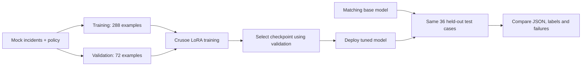

# LLM Fine-Tuning — a ByteMonk hands-on lab

Teach a small language model to turn an incident report into consistent JSON. Start with mock data, fine-tune with LoRA on **Crusoe Intelligence Foundry**, and compare the result with the original model.

**Start locally in two minutes.** You need Python 3.10+ and Git. The local exercises need no GPU, API key, or paid account. Running your own training and inference requires a Crusoe account and incurs usage charges.

## What you will learn

Fine-tuning trains an existing model on examples of the behavior you want. Here, each example pairs an incident with its category, severity, and responsible team. **LoRA** learns a small set of adapter weights while keeping the base model weights frozen; you serve the adapter with its base model, or a merged version.

The prompt supplies the rules, and training supplies examples. We give the **same rules to both models** so the comparison measures the effect of tuning under that shared prompt.

Example input:

> Payment API returning HTTP 503 for 40% of requests across multiple regions.

Expected answer under this lab's [policy](policy.txt):

```json
{"category":"PAYMENT_FAILURE","severity":"SEV1","team":"PAYMENTS"}
```

These are fictional incidents and illustrative rules. No real incident data is needed.

## How it works



Training examples teach the task. Validation helps choose a checkpoint. The test set stays out of training and checkpoint selection, so it checks behavior on separate examples.

## 1. Clone and explore locally

The repository is currently private; your GitHub account needs access.

```bash
git clone https://github.com/bytemonk-academy/llm-fine-tuning.git
cd llm-fine-tuning
python3 demo.py validate
python3 demo.py sample-results
```

Validation should report **288 training, 72 validation, and 36 test records**, with no exact duplicate incidents. `sample-results` scores the included **saved responses** from our earlier run; it does not run a model or contact Crusoe.

Open `data/train.jsonl`. Each line contains three messages: the system policy, a user incident, and the expected assistant JSON. All labels follow `policy.txt`.

## 2. Fine-tune on Crusoe

1. Sign in to [Crusoe Console](https://console.crusoecloud.com), open **Intelligence Foundry**, and select your project.
2. Open **Serverless Fine-Tuning** and start a job. Choose a small model supported for both fine-tuning and deployment in your account. Our recorded run used **Qwen3.5 2B**; availability can change.
3. Upload `data/train.jsonl` as training data and `data/validation.jsonl` as validation data. **Do not upload the test set for training.**
4. Use the console's default settings for your first experiment. Review the cost estimate, then launch. Record the model and resolved settings.
5. When the job completes, inspect training/validation loss and choose a checkpoint using validation performance. Low loss alone does not tell you how many classifications are correct.

See Crusoe's [fine-tuning guide](https://docs.crusoe.ai/serverless-fine-tuning/fine-tune-a-model/index.html) for current controls and supported settings.

## 3. Deploy and compare

1. Create a deployment from the chosen checkpoint. Also make the **matching untuned base model** available. Use comparable serving configurations.
2. For a quick visual check, paste the same policy and incident into each model's playground. Start a fresh conversation for each case.
3. For all 36 test cases, follow the short [CLI guide](docs/CLI.md). It saves responses and compares exact match, individual labels, JSON validity, and missed critical incidents.
4. Inspect failures as well as successes. Delete temporary dedicated deployments when finished to stop ongoing compute charges.

The [deployment guide](https://docs.crusoe.ai/self-serve-deployments/quickstart/index.html) explains serving a base model or LoRA adapter. Training and deployment are separate steps and separate charges.

## What happened in our run?

On October 30, 2026, we trained and evaluated Qwen3.5 2B through the Crusoe console:

| Result on 36 synthetic test cases | Base | Fine-tuned |
|---|---:|---:|
| All three fields correct | 11/36 | 27/36 |
| Valid JSON | 36/36 | 36/36 |
| Critical incidents missed — lower is better | 10/12 | 6/12 |

The model improved but still missed serious cases. This small, correlated synthetic dataset demonstrates the workflow; it does **not** establish production reliability. Your run may differ. Read the [short experiment report](docs/RESULTS.md) and inspect the raw responses in `examples/`.

## Try changing it

Add new training scenarios in `build_dataset.py`, regenerate with `python3 build_dataset.py`, and validate again. The generator overwrites the three dataset files and policy, so commit any manual changes first. Improve training examples without copying test answers into training; use a fresh held-out set for later experiments.

| File | Purpose |
|---|---|
| `policy.txt` | Human-readable classification rules |
| `data/*.jsonl` | Ready-to-use mock datasets |
| `build_dataset.py` | Reproducible dataset generator |
| `demo.py` | Local checks, saved-result comparison, optional API workflow |
| `examples/` | Recorded base and tuned outputs |
| `docs/CLI.md` | Optional upload, training, and evaluation commands |

The dataset format and evaluation idea are reusable with other providers. The included cloud commands use Crusoe. Trained weights and a live endpoint are not included.
